<p align="center">
  
</p>

<p align="center">
  <a href="https://github.com/ishandutta2007/Awesome-Awesome-Awesome"></a><a href="https://discord.gg/jc4xtF58Ve"></a>
  <a href="https://github.com/ishandutta2007/Awesome-Shell-Prompts/stargazers"></a>
  <a href="https://github.com/ishandutta2007/Awesome-Shell-Prompts/blob/main/LICENSE"></a>
  <a href="https://github.com/ishandutta2007/Awesome-Shell-Prompts/pulls"></a>
  <a href="https://github.com/ishandutta2007"></a>
</p>

# ⚡ Awesome Shell Prompts 🐚

> **A curated directory of elite SaaS platforms, cloud environments, and open-source GitHub projects for Shell Prompts and Terminal Customization.**  
> *Focused on sub-millisecond prompt rendering, cross-shell portability (Bash, Zsh, Fish, PowerShell, Nushell), dynamic git integration, and maximum developer productivity.*

---

## 📑 Table of Contents
- [📊 Sector Overview & Market Dynamics](#-sector-overview--market-dynamics)
- [☁️ SaaS & Hosted Platforms](#️-saas--hosted-platforms)
- [🌟 Open-Source GitHub Projects (Ranked by Stars)](#-open-source-github-projects-ranked-by-stars)
- [⚡ Architecture & Performance Benchmark Insights](#-architecture--performance-benchmark-insights)
- [🛠️ How to Choose the Right Prompt](#️-how-to-choose-the-right-prompt)
- [🤝 How to Contribute](#-how-to-contribute)
- [💖 Support & Community](#-support--community)
- [📈 Star History](#-star-history)
- [⚖️ Disclaimer](#️-disclaimer)

---

## 📊 Sector Overview & Market Dynamics

The global terminal emulator, CLI productivity tooling, and cloud development environment sector represents an estimated addressable market of **$5.2 billion to $8.5 billion**, expanding at an aggressive CAGR of ~18% driven by pervasive cloud-native deployments and AI-assisted terminal agents.

Market dynamics reveal **moderate fragmentation at the local developer workstation layer**—where hundreds of independent open-source prompts, plugin managers, and custom dotfiles thrive without a single dominant monopolistic lock-in—contrasted with **high, winner-take-most concentration in the enterprise cloud and AI-assisted terminal workspace layer**, where hyper-scalers (such as Microsoft GitHub Codespaces) and well-funded venture-backed innovators command market share and unified telemetry.

---

## ☁️ SaaS & Hosted Platforms

| Product & Organization | Company Size / Valuation | Starting Tier Pricing | Free Tier Limit | Key Highlights & Prompt Capabilities |
| :--- | :--- | :--- | :--- | :--- |
| **[GitHub Codespaces](https://github.com/features/codespaces)** *(Microsoft)* | **$3.1 Trillion** *(Market Cap)* | **$0.18 / core-hour** *(~ $18.00/mo for 2-core)* | **60 core-hours + 15 GB storage free every month forever** | Cloud-hosted Linux development containers with automatic dotfiles synchronization, instant browser/SSH terminal prompt initialization, and pre-configured Zsh/Bash themes. |
| **[Warp Terminal](https://www.warp.dev/)** *(Warp Technologies, Inc.)* | **$500 Million** *(Valuation; $73M venture funding)* | **$20.00 / user / month** *(Build/Team plan)* | **Free forever for individuals & up to 3 team members**, with **100 AI requests/month** and **20 shared Warp Drive workflows** | Modern Rust-based AI terminal with an integrated prompt theme engine, custom block renderers, parameter completion, and cloud-synced team workflows. |
| **[Gitpod](https://www.gitpod.io/)** *(Gitpod GmbH)* | **$300 Million** *(Valuation; $41M venture funding)* | **$9.00 / user / month** *(Flex individual plan)* | **50 hours / month workspace runtime free forever** with full dotfiles, Starship, and custom Zsh/Bash prompt persistence | Automated cloud developer environments that bootstrap terminal dotfiles, instant-rendering prompts, and pre-built toolchains upon repository clone. |
| **[Termius](https://termius.com/)** *(Termius Inc.)* | **$35 Million** *(Est. Valuation; $4.0M ARR)* | **$10.00 / user / month** *(Pro plan billed annually at $120/yr)* | **Free Starter plan forever on up to 2 devices**, local SSH/SFTP vault, terminal tabs, and basic prompt theme selection without cloud sync | Cross-platform terminal client with cloud-synced SSH configurations, customized prompt fonts, color themes, and snippet execution across desktop and mobile. |
| **[Wave Terminal](https://www.waveterm.dev/)** *(Command Line Inc.)* | **$8 Million** *(Est. Valuation; Seed stage)* | **$16.00 / user / month** *(Cloud Team tier)* | **Free forever for individual local use**, unlimited tabs, inline web/graph previews, and Bring-Your-Own-Key (BYOK) AI prompt queries | Open-core workspace terminal blending terminal prompt command execution with inline graphical widgets, web browser cards, and persistent session trees. |
| **[Oh My Posh Cloud & Support](https://ohmyposh.dev/)** *(JanDeDobbeleer)* | **$250K ARR** *(Bootstrapped & GitHub Sponsors)* | **$10.00 / month** *(Team Supporter sponsorship tier)* | **Free forever under MIT license for all local shells**, 100+ themes, JSON/YAML configuration engines, and CLI binary updates without restrictions | Hosted theme gallery, enterprise prompt deployment assistance, and priority engineering support for cross-shell prompt infrastructure. |
| **[iTerm2 Shell Integration](https://iterm2.com/)** *(George Nachman)* | **$120K ARR** *(Open Collective & Patreon Sponsorship)* | **$5.00 / month** *(Supporter tier on Patreon)* | **Free forever under GPL-2.0 license**, unlimited prompt marks, status bar modules, command duration tracking, and automatic directory detection | Deep native macOS terminal integration enabling prompt return-code markers, remote host badge indicators, profile triggers, and click-to-move prompt cursors. |

---

## 🌟 Open-Source GitHub Projects (Ranked by Stars)

The following repositories represent the leading open-source shell prompt engines, frameworks, and themes across Bash, Zsh, Fish, PowerShell, and cross-shell architectures, sorted in descending order of GitHub stargazers:

### 1. [Oh My Zsh](https://github.com/ohmyzsh/ohmyzsh) [](https://github.com/ohmyzsh/ohmyzsh/stargazers)
- **Primary Shell:** Zsh 🐚
- **License:** MIT 📄
- **Description:** The undisputed titan of command-line customization. A community-driven framework for managing Zsh configurations bundled with 300+ plugins and 150+ themes. Provides instant out-of-the-box battery power for Git branch detection, auto-completions, and productivity aliases.
- **Controlled Benchmark:** ~148ms cold-start latency when configured with 6 standard plugins (versus 45ms unconfigured baseline).
- **Best Suited For:** Developers who want a full-featured, batteries-included Zsh environment with zero initial setup overhead.

### 2. [Starship](https://github.com/starship/starship) [](https://github.com/starship/starship/stargazers)
- **Primary Shell:** Universal / Cross-Shell *(Bash, Zsh, Fish, PowerShell, Nushell, Ion, Elvish, Xonsh)* 🌐
- **License:** ISC 📄
- **Description:** The premier cross-shell prompt engine written in Rust. Compiles to a single standalone static binary with zero external runtime dependencies. Configured via a single unified `starship.toml` file that delivers the exact same prompt visual experience across macOS, Linux, and Windows.
- **Controlled Benchmark:** Sub-10ms prompt rendering times; async execution ensures heavy git repositories never block keystroke response.
- **Best Suited For:** Engineers working across multiple shells and platforms who demand blistering speed, comprehensive language version modules, and cloud provider context.

### 3. [Powerlevel10k](https://github.com/romkatv/powerlevel10k) [](https://github.com/romkatv/powerlevel10k/stargazers)
- **Primary Shell:** Zsh 🐚
- **License:** MIT 📄
- **Description:** The pinnacle of Zsh performance engineering. Famous for its revolutionary **Instant Prompt** technology, which displays an interactive, fully rendered prompt before Zsh has even completed loading plugins or sourcing scripts. Features an interactive guided setup wizard (`p10k configure`).
- **Controlled Benchmark:** Measured at ~25ms startup latency—demonstrating rendering speeds faster than an unconfigured Zsh baseline shell.
- **Best Suited For:** Zsh enthusiasts who want rich glyphs, multi-line layouts, and extensive status segments without sacrificing a single millisecond of terminal responsiveness.

### 4. [Fish Shell Prompt (Built-in)](https://github.com/fish-shell/fish-shell) [](https://github.com/fish-shell/fish-shell/stargazers)
- **Primary Shell:** Fish 🐟
- **License:** GPL-2.0 📄
- **Description:** Fish's native interactive prompt architecture defined cleanly via `fish_prompt` and `fish_right_prompt` functions. Includes native git status awareness via `__fish_git_prompt` with syntax highlighting and autosuggestions as first-class citizens.
- **Best Suited For:** Developers using Fish who desire native, lightweight performance without installing external third-party prompt frameworks.

### 5. [Oh My Posh](https://github.com/JanDeDobbeleer/oh-my-posh) [](https://github.com/JanDeDobbeleer/oh-my-posh/stargazers)
- **Primary Shell:** Universal / Cross-Shell *(PowerShell, Bash, Zsh, Fish, Nushell, Cmd)* 🪟
- **License:** MIT 📄
- **Description:** A cross-platform prompt theme engine written in Go. The de-facto standard prompt manager on Windows and PowerShell, while also running seamlessly on Linux and macOS. Features a JSON/YAML/TOML configuration architecture and an extensive gallery of community themes.
- **Best Suited For:** PowerShell power users, cross-platform engineers, and terminal artists seeking sophisticated segment transitions and deep cloud telemetry (AWS, Azure, GCP, Kubernetes).

### 6. [Spaceship Prompt](https://github.com/spaceship-prompt/spaceship-prompt) [](https://github.com/spaceship-prompt/spaceship-prompt/stargazers)
- **Primary Shell:** Zsh 🚀
- **License:** MIT 📄
- **Description:** A minimalistic, modular, and extremely customizable Zsh prompt. Built on an independent sections architecture that only displays relevant contextual information (Node.js, Rust, Docker, Kubernetes, Python, Git status) based on the current directory's manifest files.
- **Best Suited For:** Full-stack developers wanting deep language runtime awareness with a clean visual aesthetic without leaving pure Zsh.

### 7. [Bash-it](https://github.com/Bash-it/bash-it) [](https://github.com/Bash-it/bash-it/stargazers)
- **Primary Shell:** Bash 🐚
- **License:** MIT 📄
- **Description:** The community-driven configuration framework for Bash. Provides a rich ecosystem of themes, aliases, completions, and plugins analogous to Oh My Zsh. Empowers default shell users on enterprise Linux systems without requiring administrative privileges to install alternate shells.
- **Best Suited For:** Systems administrators and engineers working primarily on standard Bash servers who want prompt themes and autocomplete utilities.

### 8. [Prezto](https://github.com/sorin-ionescu/prezto) [](https://github.com/sorin-ionescu/prezto/stargazers)
- **Primary Shell:** Zsh ⚡
- **License:** MIT 📄
- **Description:** The instigator of high-performance Zsh frameworks. Engineered as a faster, leaner alternative to Oh My Zsh, organizing functionality into well-structured modules (editor, history, syntax highlighting, and themes) with strict performance discipline.
- **Best Suited For:** Developers seeking an organized, disciplined Zsh foundation with lower latency overhead than standard monolithic frameworks.

### 9. [Pure](https://github.com/sindresorhus/pure) [](https://github.com/sindresorhus/pure/stargazers)
- **Primary Shell:** Zsh 🎨
- **License:** MIT 📄
- **Description:** The iconic minimalist Zsh prompt created by Sindre Sorhus. Strips away visual clutter, icons, and bulky powerline symbols in favor of clean single-line minimalism, asynchronous git checking, and execution time badges for commands exceeding 5 seconds.
- **Best Suited For:** Minimalist developers who prize clean typography, unobtrusive layouts, and distraction-free terminal workspaces.

### 10. [Oh My Fish](https://github.com/oh-my-fish/oh-my-fish) [](https://github.com/oh-my-fish/oh-my-fish/stargazers)
- **Primary Shell:** Fish 🐟
- **License:** MIT 📄
- **Description:** The quintessential package manager and theme framework for the Fish shell. Provides an intuitive package CLI (`omf install <theme>`) for rapidly sampling, installing, and switching between dozens of community-crafted Fish prompts.
- **Best Suited For:** Fish shell explorers who want one-command theme switching and curated plugin installation.

### 11. [Antigen](https://github.com/zsh-users/antigen) [](https://github.com/zsh-users/antigen/stargazers)
- **Primary Shell:** Zsh 📦
- **License:** MIT 📄
- **Description:** A classic plugin manager for Zsh inspired by pathogen.vim. Enables developers to declare plugins, themes, and Oh My Zsh bundles directly within `.zshrc` using a clean `antigen bundle` declarative syntax.
- **Best Suited For:** Zsh users wanting declarative plugin and prompt theme management with broad Oh My Zsh ecosystem compatibility.

### 12. [Powerline-Shell](https://github.com/b-ryan/powerline-shell) [](https://github.com/b-ryan/powerline-shell/stargazers)
- **Primary Shell:** Universal *(Bash, Zsh, Fish, Tcsh)* 🐍
- **License:** MIT 📄
- **Description:** A Python-based prompt generator that renders classic Powerline segmented status bars across virtually any terminal. Displays current Git status, virtualenv name, exit codes, and background jobs with customizable segment order.
- **Best Suited For:** Python developers wanting an easily scriptable, segment-driven prompt across standard Unix and Linux shells.

### 13. [Zplug](https://github.com/zplug/zplug) [](https://github.com/zplug/zplug/stargazers)
- **Primary Shell:** Zsh ⚡
- **License:** MIT 📄
- **Description:** A next-generation Zsh plugin manager featuring parallel installation and updates, lazy-loading triggers, and GitHub release binary integration. Manages prompt themes alongside binaries and plugins seamlessly.
- **Best Suited For:** Power users looking for parallelized dependency management and granular hook configuration for Zsh themes.

### 14. [Zinit](https://github.com/zdharma-continuum/zinit) [](https://github.com/zdharma-continuum/zinit/stargazers)
- **Primary Shell:** Zsh ⚡
- **License:** MIT 📄
- **Description:** An ultra-fast, flexible Zsh plugin and prompt engine. Pioneered **Turbo Mode**, which defers plugin initialization until after the prompt renders, ensuring that heavy Zsh setups feel instant. Supports ice modifiers for granular control over compilation and snippet caching.
- **Best Suited For:** Advanced Zsh power users who demand sub-40ms startup benchmarks even with dozens of active plugins.

### 15. [Zimfw (Zim: Zsh IMproved)](https://github.com/zimfw/zimfw) [](https://github.com/zimfw/zimfw/stargazers)
- **Primary Shell:** Zsh 🚀
- **License:** MIT 📄
- **Description:** A high-speed, modular Zsh configuration framework. Employs byte-compilation of all sourced files and templates to dramatically shave milliseconds off terminal boot times. Bundles an array of prompt themes and autocomplete tools.
- **Best Suited For:** Developers seeking the speed of a hand-rolled `.zshrc` with the convenience and safety of a curated module framework.

### 16. [Liquid Prompt](https://github.com/nojhan/liquidprompt) [](https://github.com/nojhan/liquidprompt/stargazers)
- **Primary Shell:** Bash & Zsh 💧
- **License:** AGPL-3.0 📄
- **Description:** An adaptive, intelligent prompt designed for system administrators. Dynamically activates visual indicators only when actionable conditions arise (e.g. high CPU load, battery drain, uncommitted git files, detached screens, or failed jobs), keeping the line clean during routine operation.
- **Best Suited For:** DevOps engineers, sysadmins, and site reliability engineers monitoring host hardware and cluster states in real time.

### 17. [Tide](https://github.com/IlanCosman/tide) [](https://github.com/IlanCosman/tide/stargazers)
- **Primary Shell:** Fish 🐟
- **License:** MIT 📄
- **Description:** The flagship modern prompt theme for Fish shell. Offers Powerlevel10k-like performance discipline, asynchronous background rendering, transient prompt support, and an interactive terminal configuration wizard (`tide configure`).
- **Best Suited For:** Fish shell users who desire rich contextual segments, sub-millisecond responsiveness, and full Powerline/Nerd Font customization.

### 18. [Agnoster Zsh Theme](https://github.com/agnoster/agnoster-zsh-theme) [](https://github.com/agnoster/agnoster-zsh-theme/stargazers)
- **Primary Shell:** Zsh 🎨
- **License:** MIT 📄
- **Description:** The legendary Powerline-style prompt theme that popularized segment-based terminal design. Features distinctive chevron dividers, user/host detection, colored git branch states, and elevated permission indicators.
- **Best Suited For:** Developers who adore the classic Powerline chevron aesthetic and Solarized color palettes.

### 19. [Powerline-Go](https://github.com/justjanne/powerline-go) [](https://github.com/justjanne/powerline-go/stargazers)
- **Primary Shell:** Universal *(Bash, Zsh, Fish)* 🐹
- **License:** GPL-3.0 📄
- **Description:** A beautiful, lightning-fast Powerline-style prompt generator compiled in Go. Optimized for high rendering throughput with plugins for Git, Mercurial, Kubernetes contexts, Docker containers, and cloud credentials.
- **Best Suited For:** Go enthusiasts wanting a compiled, single-binary prompt engine without external interpreter overhead.

### 20. [Bullet Train Zsh](https://github.com/caiogondim/bullet-train.zsh) [](https://github.com/caiogondim/bullet-train.zsh/stargazers)
- **Primary Shell:** Zsh 🚄
- **License:** MIT 📄
- **Description:** A stylish prompt theme for Zsh inspired by Agnoster, featuring segment dividers shaped like high-speed train cars. Supports custom status codes, Node/Ruby/Python version markers, and background job notifications.
- **Best Suited For:** Full-stack developers wanting high visual contrast and playful segment cues.

### 21. [Znap (zsh-snap)](https://github.com/marlonrichert/zsh-snap) [](https://github.com/marlonrichert/zsh-snap/stargazers)
- **Primary Shell:** Zsh ⚡
- **License:** MIT 📄
- **Description:** A rapid Zsh plugin manager and rapid boot engine written entirely in native Zsh. Automates Git cloning, asynchronous cache generation, and deferred loading to ensure prompt themes initialize instantly.
- **Best Suited For:** Minimalist Zsh users wanting blisteringly fast startup times without external compilation pipelines.

### 22. [Agkozak Zsh Prompt](https://github.com/agkozak/agkozak-zsh-prompt) [](https://github.com/agkozak/agkozak-zsh-prompt/stargazers)
- **Primary Shell:** Zsh 🛡️
- **License:** MIT 📄
- **Description:** An asynchronous, lightweight Zsh prompt that renders instantly even on slow network file systems (NFS), giant monorepos, and remote SSH connections. Features customizable left and right prompts with zero external dependencies.
- **Best Suited For:** Engineers frequently working over SSH or inside enterprise NFS repositories where file system latency stalls traditional prompts.

---

## ⚡ Architecture & Performance Benchmark Insights

Terminal prompt rendering latency directly impacts developer focus and shell interactivity. Every keystroke and new terminal tab invokes the prompt generation lifecycle:

```
┌────────────────────────────────────────────────────────────────────────┐
│                   Shell Prompt Lifecycle & Latency                     │
└────────────────────────────────────────────────────────────────────────┘
       Shell Startup ───► Git State Poll ───► Cloud/Runtime ───► Prompt Render
  [Oh My Zsh monolithic: ~148ms]  [Async Powerlevel10k: ~25ms]  [Starship Rust: <10ms]
```

### ⏱️ Controlled Benchmark Summary
- **Unconfigured Shell Baseline:** ~45ms cold startup.
- **Monolithic Frameworks (Oh My Zsh with 6 standard plugins):** ~148ms cold startup — plugins execute synchronously before the prompt draws.
- **Deferred / Turbo Frameworks (Zinit / Znap):** ~40ms cold startup — non-critical plugins load in background threads after visual prompt availability.
- **Instant Prompt (Powerlevel10k):** ~25ms cold startup — interactive snapshot renders before shell script evaluation finishes.
- **Compiled Native Binary (Starship in Rust):** Sub-10ms prompt execution — multi-threaded, parallelized module resolution written in memory-safe compiled code.

---

## 🛠️ How to Choose the Right Prompt

| Your Priority / Environment | Recommended Choice | Rationale |
| :--- | :--- | :--- |
| **I use multiple shells (Bash, Zsh, Fish, PowerShell)** | 🚀 **Starship** | Single `starship.toml` configuration works everywhere with identical behavior and sub-10ms speed. |
| **I want the fastest possible Zsh prompt with maximum info** | ⚡ **Powerlevel10k** | Instant Prompt renders immediately, visual configuration wizard makes setup effortless. |
| **I live in Windows / PowerShell** | 🪟 **Oh My Posh** | Unequaled Windows terminal font integration, deep Azure/GCP/AWS segments, vibrant themes. |
| **I use the Fish shell** | 🐟 **Tide** | Powerlevel10k caliber async rendering with interactive configuration wizard built for Fish. |
| **I want a clean, minimalist prompt with no clutter** | 🎨 **Pure** | Minimalist single-line layout, async git markers, command execution timing. |
| **I want all plugins, completions, and aliases out of the box** | 🐚 **Oh My Zsh** | The largest community in existence with 300+ plugins and universal troubleshooting guides. |
| **I work over slow SSH connections or huge Git monorepos** | 🛡️ **Agkozak** | Fully asynchronous Git calculation that never locks the terminal cursor on slow disks. |

---

## 🤝 How to Contribute

Contributions are warmly welcomed! Help keep this directory accurate, comprehensive, and up-to-date:

1. 🍴 **Fork the repository** on GitHub.
2. 🌿 **Create a feature branch:** `git checkout -b feature/new-prompt-tool`.
3. 📝 **Add or edit entries in `README.md`:** Ensure accurate URLs, specific pricing/free-tier metrics, and factual benchmarks.
4. 🚀 **Submit a Pull Request** with a concise description of your additions.

Check out our [Awesome-Awesome-Awesome](https://github.com/ishandutta2007/Awesome-Awesome-Awesome) meta-collection for more curated developer resources.

---

## 💖 Support & Community

If you found **Awesome Shell Prompts** valuable for optimizing your terminal workflow, please consider supporting the project:

- ⭐ **Star this repository** to improve discoverability for other developers!
- 🍴 **Fork and share** with your teammates and engineering organizations.
- 💬 **Join our community** on [Discord](https://discord.gg/jc4xtF58Ve) to discuss shell performance and prompt configurations.
- ☕ **Sponsor the Maintainer:** Consider buying a coffee or contributing to continued open-source development via the [GitHub Sponsor Dashboard](https://github.com/sponsors/ishandutta2007).

---

## 📈 Star History

[](https://star-history.dera.page/#ishandutta2007/Awesome-Shell-Prompts&type=date&legend=top-left)

---

## ⚖️ Disclaimer

- This is a **community-curated directory** provided for educational and developer productivity purposes; inclusion does not constitute commercial endorsement.
- Startup latency benchmarks are measured under controlled testing conditions; real-world performance will vary based on hardware, operating system, filesystem performance, and active terminal plugins.
- Most icon-rich prompts require a **[Nerd Font](https://www.nerdfonts.com/)** (such as *FiraCode Nerd Font*, *JetBrainsMono Nerd Font*, or *MesloLGS NF*) installed and selected in your terminal emulator to prevent glyph rendering issues.

---

<p align="center">
  <b>Built with ⚡ and passion for the global terminal and developer community.</b><br>
  <sub>Released under the <a href="LICENSE">MIT License</a>.</sub>
</p>
